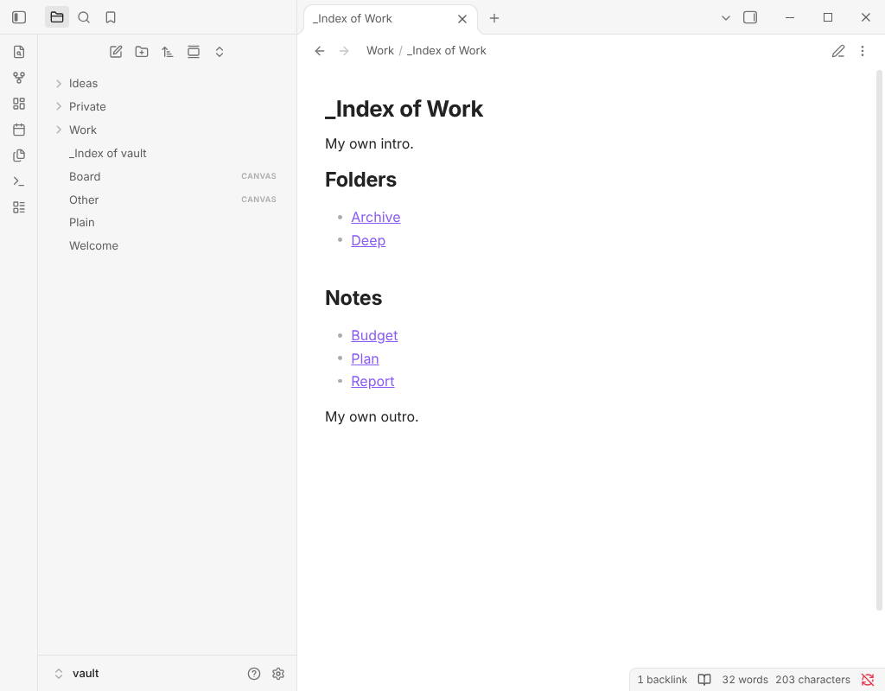

# Folder Index Notes

Keeps an index note in each folder up to date with links to the notes and subfolders inside it.



## Why this one

- **Only touches its own block.** The list lives between two comment markers; anything you write above or below stays.
- **Stays current by itself.** Add, rename, move or delete a note and the index of that folder (and the one it left) updates a moment later.
- **Nothing is created behind your back.** One command creates indexes in every folder once, after showing how many folders it will touch; automatic creation is a setting that starts off.
- **Real links.** Links are made by Obsidian, so your link format setting applies, and renamed notes keep working.
- **Sensible order.** Natural sorting, so Note 2 comes before Note 10.

## Usage

Run **Create or update indexes in all folders**. It asks first, then writes an index note named `_Index of <folder>` in each folder that has notes, listing subfolders and notes. From then on, indexes that exist are kept up to date.

Run **Update this note's folder index** to create or refresh just one folder.

An index looks like this:

```markdown
<!-- folder-index:start -->
## Folders

- [[_Index of Archive|Archive]]

## Notes

- [[Budget]]
- [[Plan]]

<!-- folder-index:end -->
```

## Settings

Keep indexes current, create missing indexes automatically, the index note name (`{{folder}}` is the folder's name), A to Z or Z to A order, the two headings (leave empty for a plain list), and folders to exclude (one per line; `Archive/*` also skips its subfolders).

## Installation

In Obsidian, open **Settings → Community plugins → Browse** and search for "Folder Index Notes".

## More plugins by Siulved54

| Plugin | What it does | Source |
| --- | --- | --- |
| [Shared Blocks](https://obsidian.md/plugins?id=shared-blocks) | Write a block of text once and reuse it in any note. Edit the source and every reference re-renders live. | [shared-blocks](https://github.com/perezamadorluisenrique-gif/shared-blocks) |
| [Text Case and Cleanup](https://obsidian.md/plugins?id=text-format) | Change case, make camelCase or slugs, sort lines and remove duplicates, and repair text pasted out of a PDF, without touching code or URLs. | [text-format](https://github.com/perezamadorluisenrique-gif/text-format) |
| [Typography as You Type](https://obsidian.md/plugins?id=typography-as-you-type) | Curly quotes, dashes and ellipses as you type, kept out of code and maths, with Backspace to take one back. | [smart-typography-plugin](https://github.com/perezamadorluisenrique-gif/smart-typography-plugin) |
| [Section Numbering](https://obsidian.md/plugins?id=section-numbering) | Number headings as an outline (1, 1.1, 1.2) and keep every link to them working when they renumber. | [section-numbering](https://github.com/perezamadorluisenrique-gif/section-numbering) |
| [Spreadsheet to Table](https://obsidian.md/plugins?id=spreadsheet-to-table) | Paste cells from Excel or Google Sheets as a Markdown table with a real header, insert CSV files, and copy tables back out. | [spreadsheet-to-table](https://github.com/perezamadorluisenrique-gif/spreadsheet-to-table) |
| [Hybrid Line Numbers](https://obsidian.md/plugins?id=hybrid-line-numbers) | Relative and hybrid line numbers for Vim-style jumps, where a folded section counts as one line. | [hybrid-line-numbers](https://github.com/perezamadorluisenrique-gif/hybrid-line-numbers) |
| [List Item Callouts](https://obsidian.md/plugins?id=list-item-callouts) | Colour a single list item as a callout by starting it with a character such as `&`, `!` or `?`. | [list-item-callouts](https://github.com/perezamadorluisenrique-gif/list-item-callouts) |
| [Folder Counts](https://obsidian.md/plugins?id=folder-counts) | See how many notes or files each folder holds, right in the file explorer, with a vault total and folder exclusions. | [folder-counts](https://github.com/perezamadorluisenrique-gif/folder-counts) |
| [Note Reading Time](https://obsidian.md/plugins?id=note-reading-time) | Reading time of the current note or your selection in the status bar, optionally saved to a property. | [note-reading-time](https://github.com/perezamadorluisenrique-gif/note-reading-time) |
| [Task Rollover](https://obsidian.md/plugins?id=task-rollover) | Roll unfinished tasks from your last daily note into today's when it is created, with a real undo. | [task-rollover](https://github.com/perezamadorluisenrique-gif/task-rollover) |
| [Zoom Into Section](https://obsidian.md/plugins?id=zoom-into-section) | Zoom into a heading or list item to see only it and its contents, with a breadcrumb bar to climb back out. | [zoom-into-section](https://github.com/perezamadorluisenrique-gif/zoom-into-section) |
| [Link Title on Paste](https://obsidian.md/plugins?id=link-title-on-paste) | Paste a web address and get a Markdown link with the page's title, fetched in the background and undone in one step. | [link-title-on-paste](https://github.com/perezamadorluisenrique-gif/link-title-on-paste) |
| [Update Radar](https://obsidian.md/plugins?id=update-radar) | Checks your installed community plugins for updates in the background, shows what changed, and flags the ones that look abandoned. | [community-update-checker](https://github.com/perezamadorluisenrique-gif/community-update-checker) |
| [Dataview to Bases](https://obsidian.md/plugins?id=dataview-to-bases) | Convert Dataview queries into Bases blocks, and see which queries in your vault can be converted. | [dataview-to-bases](https://github.com/perezamadorluisenrique-gif/dataview-to-bases) |
| [Line Editing Commands](https://obsidian.md/plugins?id=line-editing-commands) | Duplicate, join, sort and reverse lines, insert blank lines and jump to a line number, with multi-cursor support. | [line-editing-commands](https://github.com/perezamadorluisenrique-gif/line-editing-commands) |
| [Note Mover Rules](https://obsidian.md/plugins?id=note-mover-rules) | Move notes into folders by ordered rules on tags, properties, titles and paths, with a preview before any bulk move. | [note-mover-rules](https://github.com/perezamadorluisenrique-gif/note-mover-rules) |
| [Tab History](https://obsidian.md/plugins?id=tab-history) | Keeps each tab's back and forward history across restarts, and adds commands to move, maximize and close tabs. | [tab-history](https://github.com/perezamadorluisenrique-gif/tab-history) |
| [URL Cards](https://obsidian.md/plugins?id=url-cards) | Shows web addresses as cards with title, description and image, and reads existing cardlink blocks. | [url-cards](https://github.com/perezamadorluisenrique-gif/url-cards) |
| [Vim Config](https://obsidian.md/plugins?id=vim-config) | Loads a vimrc-style file from your vault so your key mappings and editor commands are ready when vim mode starts. | [vim-config](https://github.com/perezamadorluisenrique-gif/vim-config) |
| [Task Archive](https://obsidian.md/plugins?id=task-archive) | Moves completed tasks, with their sub-items, into an archive section or note. | [task-archive](https://github.com/perezamadorluisenrique-gif/task-archive) |
| [Revisit Later](https://obsidian.md/plugins?id=revisit-later) | Link the current note into a future daily note, with a date typed in plain English, so it comes back when you want to review it. | [revisit-later](https://github.com/perezamadorluisenrique-gif/revisit-later) |
| [Explorer Colors Plus](https://obsidian.md/plugins?id=explorer-colors-plus) | Color files and folders in the file explorer, with a palette, cascading to children, and import from File Color. | [explorer-colors-plus](https://github.com/perezamadorluisenrique-gif/explorer-colors-plus) |
| [Book Lookup](https://obsidian.md/plugins?id=book-lookup) | Create book notes from Open Library or Google Books, with cover images, ISBN search and Book Search compatible templates. | [book-lookup](https://github.com/perezamadorluisenrique-gif/book-lookup) |
| [Web Search Menu](https://obsidian.md/plugins?id=web-search-menu) | Search the web for selected text or the note title from the right-click menu, with engines you define. | [web-search-menu](https://github.com/perezamadorluisenrique-gif/web-search-menu) |
| [Word Lookup](https://obsidian.md/plugins?id=word-lookup) | Look up any word in a sidebar dictionary with definitions, phonetics, synonyms and antonyms, or create a note for it. | [word-lookup](https://github.com/perezamadorluisenrique-gif/word-lookup) |
| [Quick Translate](https://obsidian.md/plugins?id=quick-translate) | Translate the selection or a whole note into another language with no account, keeping links, code and front matter untouched. | [quick-translate](https://github.com/perezamadorluisenrique-gif/quick-translate) |
| [Dice Rolls](https://obsidian.md/plugins?id=dice-rolls) | Inline dice rolls you click to reroll, in Live Preview and Reading view, with full dice notation, a roll dialog and a roll history. Reads Dice Roller notes. | [dice-rolls](https://github.com/perezamadorluisenrique-gif/dice-rolls) |
| [Claude Studio](https://obsidian.md/plugins?id=claude-studio) | Notion-style AI writing, chat and vault tools powered by your local Claude Code CLI. | [claude-studio](https://github.com/perezamadorluisenrique-gif/claude-studio) |
| [Book Studio](https://obsidian.md/plugins?id=book-studio) | Turn notes into a print-ready paperback PDF and an EPUB 3, entirely on your device. | [book-studio](https://github.com/perezamadorluisenrique-gif/book-studio) |
| [Emoji Search](https://obsidian.md/plugins?id=emoji-search) | Insert emojis from a searchable picker or by typing a :shortcode. | [emoji-search](https://github.com/perezamadorluisenrique-gif/emoji-search) |
| [Inline TOC](https://obsidian.md/plugins?id=inline-toc) | Show a live table of contents inside any note with a toc code block, or insert a plain Markdown one. | [inline-toc](https://github.com/perezamadorluisenrique-gif/inline-toc) |
| [Run Code Blocks](https://obsidian.md/plugins?id=run-code-blocks) | Adds a Run button to code blocks and shows the output right below, for JavaScript, Python, shell and more. | [run-code-blocks](https://github.com/perezamadorluisenrique-gif/run-code-blocks) |
| [Canvas Finder](https://obsidian.md/plugins?id=canvas-finder) | Fuzzy-search the cards and files on a canvas and jump straight to the match. | [canvas-finder](https://github.com/perezamadorluisenrique-gif/canvas-finder) |

All of them are in the community directory: Settings -> Community plugins ->
Browse, then search for the name. Demos and install links for every one:
[the catalog](https://perezamadorluisenrique-gif.github.io/catalog/).

Follow new plugins and updates on X: [@luenpereza](https://x.com/luenpereza)
